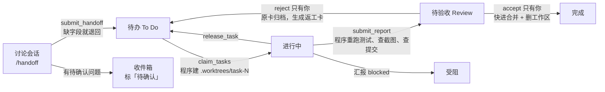

# 交接单流程：程序管规矩

2026-11 起，ProjectInbox 不再只靠一大段提示词约束 agent。交接单、工作区、状态推进都由程序检查，任何 agent（Claude Code、Codex、Hermes、pi……）都只能从同一扇门进出。



## 交接单 handoff/v1

讨论结束时，agent 调用 `get_handoff_template` 拿空表，填好后调用 `submit_handoff`。程序检查这些格子，少一个就退回并说明怎么补：

| 格子 | 写什么 | 检查 |
|---|---|---|
| project | 哪个项目 | 必须已注册；写错会列出候选 |
| title / why / goal | 标题、为什么做、做完能看到什么 | 不能空，标题一行 |
| scope.do / scope.dont | 这次做 / 这次不做 | 各至少 1 条 |
| current_state | `{investigated: true, notes: ...}` 或 `{investigated: false}` | 必须明确选 |
| acceptance | 3–6 条 `{id: A1, kind: 参照物/必须看到/不能破坏, text}` | 少于 3 退回；多于 6 要求拆卡；至少 1 条必须看到、1 条不能破坏 |
| verify | `{tests: 测试命令, screenshots: true/false}` | 测试命令必填，真没有写 `none` |
| open_questions | 没定的问题 | 不为空时卡片留在收件箱、标「待确认」，不能领取 |
| decisions / needs_approval / task_id | 可选 | `task_id` 表示补到已有卡片上 |

合格后：卡片进待办，验收清单变成看板上的勾选框（`[A1][必须看到] ……`），交接单全文写进卡片的「实施计划」，原件存在 `work/handoffs/TASK-N.yaml`。问题确认后，带上 `task_id` 重新提交一次就会进待办。

## 领取：程序建工作区

`claim_tasks` 只领待办里带合格交接单的卡。程序在项目里建 `.worktrees/task-N`（分支 `task-N`，从项目主目录当前分支的最新提交开出），并把 `/.worktrees/` 写进该项目的 `.git/info/exclude`：只在本机生效，不改项目文件。同一张卡不能被两个会话同时领。领取包里有交接单、工作区路径、截图目录和空汇报单。

做不了用 `release_task` 放回并写原因，工作区保留，下次领取沿用。工作区文件夹被手动删掉时，再次领取会按任务分支重建（已提交的改动都还在分支上），不会领到一个不存在的路径。

## 汇报单 report/v1：程序当场核验

`submit_report` 先查格子（每条验收 A1、A2……都要有结果，「未测」必须写原因，要有 Mermaid 流程图），再查事实：

1. 截图文件真的在 `work/evidence/TASK-N/` 里，而且不是空文件；
2. 工作区停在任务分支 `task-N` 上（切到别的分支提交会被拒收），任务分支上有新提交，工作区没有没提交的改动（返工时必须比上次汇报多出新提交）。主分支上已有的提交不算新提交：只把任务分支快进或变基到最新主分支，不等于提交了改动；
3. 程序自己在工作区重跑交接单的测试命令（默认限时 900 秒，可在 `config/settings.yaml` 设 `verify_timeout_seconds`；超时就停掉整个进程组。测试输出写进临时文件，程序只等测试命令自己退出：它留下的后台进程即使一直占着输出，也不会把已经跑完的测试判成超时，更不会卡住汇报）。

全部通过才进待验收，汇报内容和核验结果写进卡片的「最终总结」，验收勾选框按结果打勾。不过就拒收，卡片停在进行中，原因写进 notes。

汇报 `blocked` 时卡片标为受阻，领取随之结束（工作区保留）。你答复后带上 `task_id` 重新提交交接单，卡片回到待办，下次领取沿用同一个工作区。

## 只有你能做的三件事（命令行，不进 MCP）

```bash
project-inbox accept TASK-N              # 验收通过：快进合并到主分支，删工作区，分支保留
project-inbox accept TASK-N --no-merge   # 只标完成，不动 git
project-inbox done TASK-N                # 同 --no-merge：只标完成、不合并；之后仍可用 accept 补做合并
project-inbox reject TASK-N --comment "橙色太刺眼"   # 原卡归档并标「已退回」，生成返工卡，沿用同一个工作区
project-inbox cancel TASK-N --reason "不做了"        # 删干净的工作区，分支保留，卡片归档
```

主分支在这期间动过、没法快进时，`accept` 不会硬合，会提示你用 `reject` 让 agent 先更新到最新主分支。工作区有没提交的改动、或不在任务分支上时，`accept` 会拒绝；汇报之后任务分支上又多了提交时也会拒绝，因为程序核验的是汇报那一刻的提交：用 `reject` 退回让 agent 重新汇报，或确认无误后自己合并、再运行 `accept TASK-N --no-merge`；有没提交的改动时 `cancel` 也会拒绝，不会丢东西。合并已完成但工作区删不掉时，卡片照常标完成，原因写进结果和 notes，工作区留着手动处理。

agent 那边：MCP 的 `update_task` 不能再改状态，notes 只能往后追加；带交接单的卡不能改项目，「交接单 / 待确认 / 已退回 / 已取消」这几个标签不能增删；MCP 的 `archive_task` 不能归档带交接单且未完成的卡；命令行 `update` 不能标完成，也不能改正在领取中的卡的状态。

## 清理旧文件夹

```bash
project-inbox workspace scan            # 列出项目旁边的 worktree、复制品，对应任务和状态
project-inbox workspace clean           # 预演：只说会处理哪些，不动文件
project-inbox workspace clean --apply   # 真正执行
```

只处理「干净、对应任务已完成或归档」的：worktree 用 git 正常移除（分支保留）；完整复制出来的仓库挪进 `work/trash/`，不永久删除。没有 git 的文件夹、有未提交改动的、有主仓库里没有的提交的、看不出对应哪个任务的，一律不动，并在表里写明原因。

文件夹对应哪个任务先看领取记录，再看名字：返工卡沿用原卡的工作区，文件夹名还是原卡的编号，只要返工卡还没完成就不会被清理。子任务的文件夹（`task-5.2`）对应子任务 TASK-5.2，不会算到 TASK-5 头上。

## /handoff 技能

```bash
uv run python -m scripts.install_skills              # 装到 Claude Code：~/.claude/skills/handoff/SKILL.md
uv run python -m scripts.install_skills --target codex   # 装成 Codex 自定义提示
```

已有同名文件且内容不同时不覆盖（加 `--force` 才覆盖）。没有技能目录的 agent，把 `prompts/handoff-skill.md` 的文字贴进对话即可，它会改用命令行 `submit-handoff` 提交。

## 看板上的「复制给 Agent」

带交接单的卡，复制出来的是几行领取指令（领取 → 只在工作区改 → 交汇报单）。没有交接单的旧卡仍是原来的长指令，行为不变。

## 还没做

- 看板上的「验收通过」「退回」按钮（需要改看板补丁并重新编译，目前用命令行）。
- 第 6 步交叉审查、按风格派给不同 agent。
